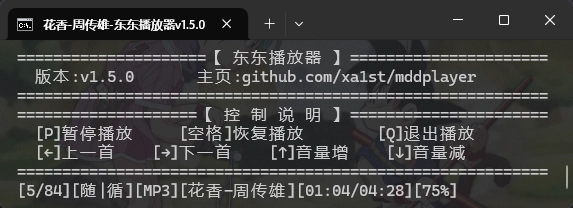

# 东东播放器 (mddplayer) 🎵


[](https://github.com/xa1st/mddplayer)
[](https://github.com/xa1st/mddplayer)
[](https://github.com/xa1st/mddplayer/issues)

[](https://github.com/xa1st/mddplayer/blob/master/LICENSE)

一款基于 **Rust** 开发的轻量级终端音频播放器，主打「简洁高效」与「终端友好」，支持主流音频格式，提供灵活的播放控制与可视化反馈。

当前播放器版本为 **v1.6.2**（更新日志见 [Changelog.md](Changelog.md)）



## ✨ 核心特性

|特性|说明|
|-|-|
| 🎧 **多格式兼容**  | 支持 MP3、FLAC、OGG、AAC（含 .m4a 容器）、WAV 五种格式，自动识别文件类型 |
| 📂 **灵活输入源**  | 支持「单个文件」「音乐目录」「TXT 播放列表」「通配符」四种输入方式，满足不同场景 |
| ⚡ **异步预加载**  | 后台线程提前解码下一首，切歌零等待；损坏或不支持的文件自动跳过 |
| 🔀 **多样播放模式** | 顺序播放、随机播放、循环播放自由组合 |
| ⌨️ **终端快捷键**  | 全键盘控制（静音 / 暂停 / 切歌 / 调音量），无需鼠标，专注听歌 |
| 📊 **实时可视化**  | 显示歌曲名、艺术家（读取音频标签）、播放进度、音量，自适应终端宽度，中日韩字符不错位 |
| 🧹 **纯净模式**   | 可隐藏说明文本，仅保留播放进度，适合极简主义用户 |

## 🚀 快速开始

### 🔍 前提条件

* 安装 Rust 环境（推荐 1.60+）：通过 [rustup](https://www.rust-lang.org/tools/install) 一键安装

* 操作系统：Linux（任意终端）、macOS（Terminal/iTerm2）、Windows（PowerShell/CMD）

### 🛠️ 安装与运行

1. **克隆仓库**

```
git clone https://github.com/xa1st/mddplayer.git

cd mddplayer
```

 **编译项目**（Release 模式优化性能）

```
cargo build --release
```

**启动播放器**（选择以下任意一种方式）

* 播放单个文件

```
./target/release/mddplayer /path/to/your/song.mp3
```

* 播放目录下所有音频

```
./target/release/mddplayer /path/folder
```

* 播放 TXT 播放列表（一行一个文件路径）

```
./target/release/mddplayer /path/folder/playlist.txt
```

* 播放通配符匹配的文件

```
./target/release/mddplayer "/path/folder/*.mp3"
```

## ⌨️ 命令行参数说明

|参数|简写|类型|说明|
|-|-|-|-|
|`--simple`|`-s`|开关|启用纯净模式，不显示程序说明与控制指南|
|`--random`|`-r`|开关|随机播放（打乱播放列表顺序），无则为顺序播放|
|`--loop`|`-l`|开关|循环播放整个列表，无则为单次播放|
|`--volume`|`-v`|数字(1-100)|设置初始音量，默认 75|

音频路径为第一个位置参数，如：`mddplayer -r -l -v 50 /path/folder`

## 🎮 终端控制指南

播放过程中，按下以下按键实现对应功能：

|按键|功能|说明|
|-|-|-|
| `P` / `p` | 静音 / 取消静音 | 再次按 `P` 恢复静音前音量 |
| 空格键       | 暂停 / 继续播放   | 同一按键切换 |
| `←` 键     | 切换到上一首       | 循环模式下第一首回绕到最后一首 |
| `→` 键     | 切换到下一首       | 循环模式下最后一首回绕到第一首 |
| `↑` 键     | 增加音量（+1%/ 次） | 静音状态下会先自动取消静音 |
| `↓` 键     | 减少音量（-1%/ 次） | 静音状态下会先自动取消静音 |
| `Q` / `q` | 退出播放器        | 恢复终端设置 |
| `Ctrl+C`  | 退出播放器        | 需按住 `Ctrl` 键再按 `C` |

## 🧩 技术栈揭秘

| 模块功能     | 依赖库         | 作用说明                              |
| -------- | ----------- | --------------------------------- |
| 音频播放与解码  | `rodio`     | 核心音频输出与播放控制（暂停 / 停止 / 音量）；MP3/FLAC/OGG/AAC(M4A) 经 symphonia 解码，WAV 经 hound 解码 |
| 音频时长计算   | `symphonia` | 精准获取音频文件总时长，解决部分格式时长识别问题（WAV 时长由 hound 解码器直接提供） |
| 标签读取 | `lofty`       | 提取歌曲名、艺术家等元数据，支持 ID3、Vorbis 等多种标签格式 |
| 终端控制与交互  | `crossterm` | 终端清屏、光标控制、实时按键监听（含修饰键识别），跨平台兼容    |
| 命令行参数解析  | `clap`      | 处理用户输入参数，支持参数组、默认值、帮助文档自动生成       |
| 随机播放洗牌   | `rand`      | 随机播放模式下打乱播放列表，确保随机性               |
| 通配符匹配    | `glob`      | 支持 `*.mp3` 等通配符模式的播放列表            |
| 字符显示宽度   | `unicode-width` | 按显示宽度截断歌曲信息，保证中日韩字符与英文混排时进度条不错位  |

## 📝 更新日志

完整的版本更新历史见 [Changelog.md](Changelog.md)。

## 📄 许可证

本项目基于 **Apache License 2.0** 开源，可自由用于个人 / 商业项目，详见 [LICENSE](LICENSE) 文件。

## 💡 温馨提示

1. 若播放列表中部分文件无法播放，可能是格式不支持，播放器会自动跳过并提示错误

2. Windows 系统下若提示「终端不支持 ANSI 转义序列」，建议使用 PowerShell 或更新版 CMD

3. 如需添加更多音频格式支持，可在 `scan_audio_files` 函数中扩展后缀名判断逻辑
